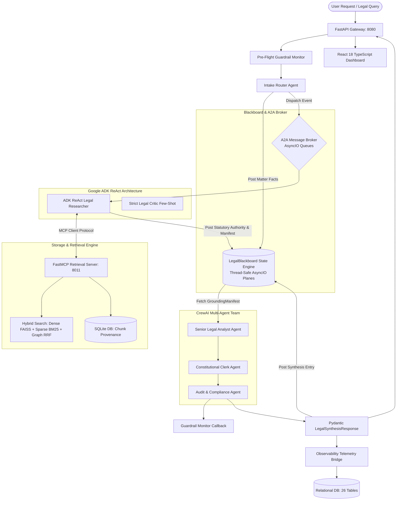
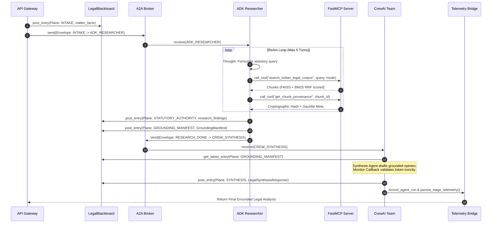
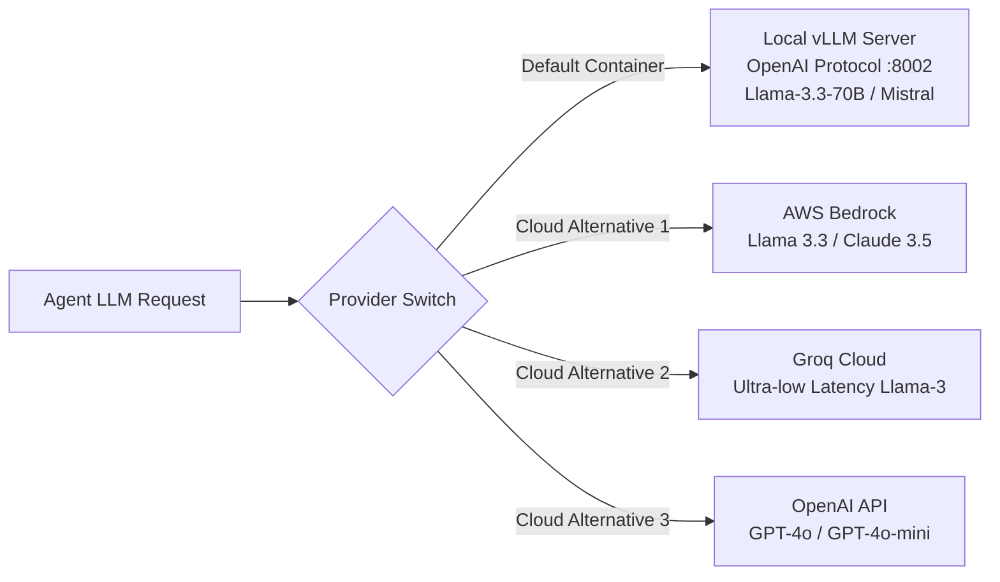
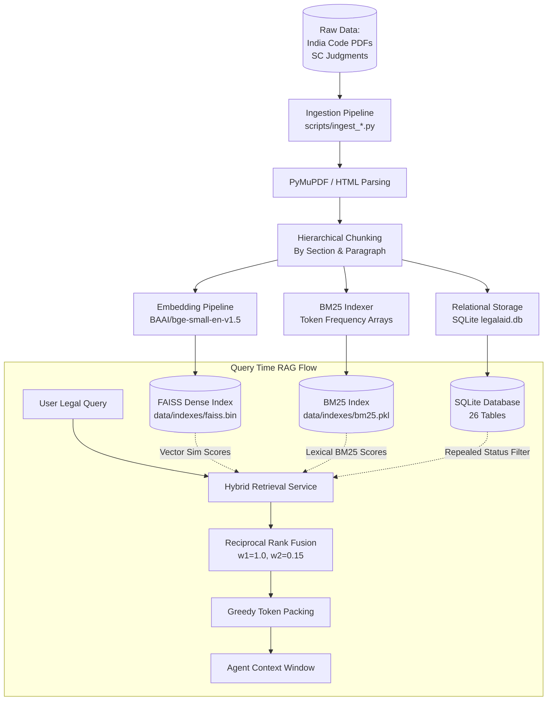
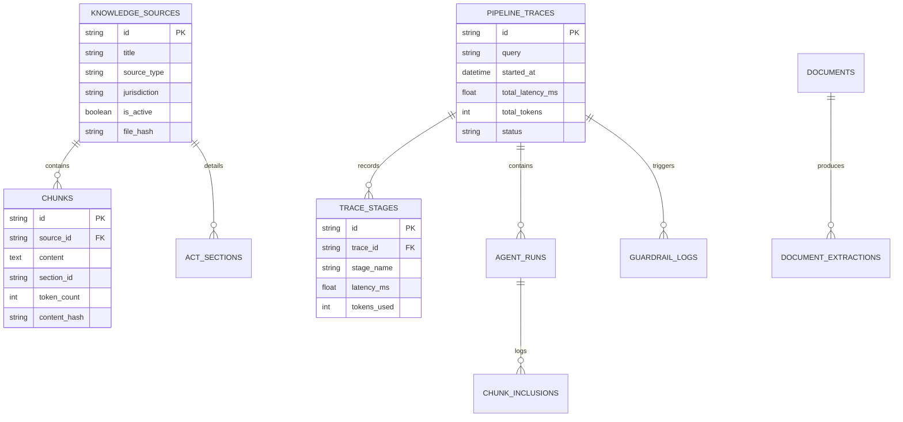
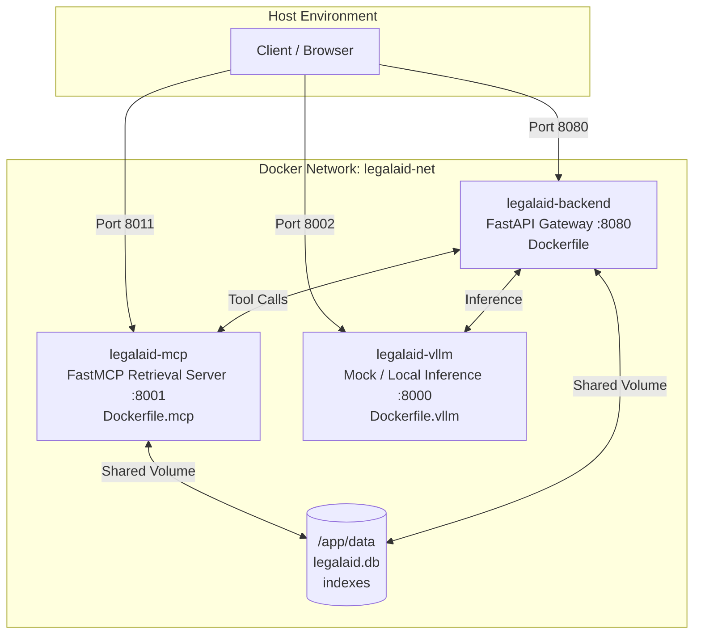

# LegalAId: Architecture, System Design & Technical Implementation Context

> **Document Version:** 2.0.0-PROD  
> **Status:** Production-Ready / Operational  
> **Target Audience:** Principal Systems Engineers, AI Coding Agents, MLOps Architects  
> **Last Verified System State:** Phase 5 Multi-Agent Containerized Cluster (17/17 Integration Tests Passing)

---

## 1. PROJECT IDENTITY

### 1.1 Overview & Executive Description
* **Project Name:** LegalAId (`legalaid-legal-research-workspace`)
* **One-Line Definition:** An enterprise-grade, multi-agent AI legal research and statutory synthesis platform engineered for Indian Law (Bharatiya Nyaya Sanhita, Code of Civil Procedure, Constitution of India, High Court/Supreme Court case precedents).
* **Dual Descriptions:**
  * **Simple Human Language:** LegalAId acts as an automated, highly-rigorous digital legal research associate and judicial clerk. It takes a legal question, factual situation, or legal document, conducts systematic statutory cross-referencing and precedent searches across official Indian legal repositories, screens out repealed laws, verifies every single cited section against real-time court and legislative records, and drafts legally grounded opinions with verifiable provenance.
  * **Technical Engineering Language:** A distributed multi-agent system combining Google Agent Development Kit (ADK) ReAct patterns and CrewAI consensus teams over a thread-safe Blackboard shared memory and an asynchronous Agent-to-Agent (A2A) event broker. It exposes a specialized Model Context Protocol (MCP) server providing Reciprocal Rank Fusion (RRF) hybrid retrieval over dense FAISS vector embeddings, sparse BM25 token frequencies, and symbolic legislative graph traversals, bounded by deterministically enforced prompt-injection guardrails, token-bucket rate limiting, and an append-only 26-table relational telemetry database.

### 1.2 Problem Domain & Why the Project Exists
1. **The Indian Legal Complexity Crisis:** The Indian legal corpus spans hundreds of Central Acts, thousands of state amendments, millions of reported High Court and Supreme Court judgments, and massive ongoing statutory overhauls (such as the transition from the Indian Penal Code [IPC] 1860 to the Bharatiya Nyaya Sanhita [BNS] 2023, CrPC to BNSS, and IEA to BSA).
2. **Hallucination Risk in Conventional LLMs:** Generic LLMs hallucinate non-existent citations, reference repealed provisions, confuse High Court territorial jurisdictions, and invent fictitious judicial precedents.
3. **Legal Provenance & Chain of Custody:** Legal professionals cannot rely on "black box" generation. Every asserted fact, section number, and judicial ratio must possess verifiable cryptographic and textual provenance back to an official gazette or authentic repository (e.g., India Code API, e-Courts, Supreme Court of India reports).

### 1.3 Target Users & Primary Use Cases
* **Target Users:** Senior Advocates, Corporate Legal Counsel, Judicial Clerks, Legal Researchers, Compliance Officers, Public Defenders, and Legal Aid Institutions.
* **Primary Use Cases:**
  1. *Statutory Research & Cross-Jurisdictional Cross-Referencing:* Identifying active statutory provisions, amendments, and repealed status under both legacy (IPC/CrPC/IEA) and modern (BNS/BNSS/BSA) frameworks.
  2. *Precedent Retrieval & Judicial Ratio Extraction:* Finding controlling Supreme Court and High Court precedents based on nuanced factual matrices.
  3. *Advisory & Motion Drafting:* Generating court-ready legal briefs, statutory opinions, and research memos grounded solely in validated chunks.
  4. *Document Verification & Fact-Checking:* Ingesting draft legal contracts or petitions, verifying statutory claims, and detecting regulatory non-compliance.

### 1.4 Key Differentiators
* **Statutory Validity & Repealed Law Filter:** Deterministic graph and metadata filters actively reject citations to repealed, superseded, or omitted legislative sections.
* **Rigid Grounding Manifest Architecture:** Synthesis agents are barred from citing any legal text not explicitly present in the cryptographic `GroundingManifest` produced during the research stage.
* **Deterministic Guardrails & Prompt Injection Filtering:** Dual-stage regex, heuristic, and embedding-based sanitization that detects adversarial jailbreaks, system-prompt extraction attempts, and unethical legal evasion queries.
* **Microservices & Multi-Framework Agent Interoperability:** Hybrid agent topologies connecting Google ADK (ReAct reasoning with dynamic tool calling) and CrewAI (multi-agent role-playing consensus) via standard MCP and A2A protocols.

---

## 2. COMPLETE TECH STACK

| Technology | Category | Version | Where Used | Purpose |
| :--- | :--- | :--- | :--- | :--- |
| **Python** | Runtime / Programming Language | `3.11.10` (Docker) / `3.10-3.14` (Host) | Full Backend (`backend/`) | Core application runtime, async services, and agents |
| **FastAPI** | Web Framework | `0.115.0+` | `backend/src/legalaid/services/gateway/app.py` | High-throughput asynchronous REST API gateway and inspection endpoints |
| **Uvicorn** | ASGI Web Server | `0.30.0+` | `backend/` entrypoints | High-performance ASGI server for FastAPI and MCP HTTP transports |
| **FastMCP** | Agent Tool Protocol | `0.4.1+` / `mcp>=1.1.2` | `backend/src/legalaid/mcp/retrieval_server.py` | Exposing hybrid search and chunk provenance tools over Model Context Protocol |
| **CrewAI** | Multi-Agent Orchestration | `0.80.0+` (Container) | `backend/src/legalaid/agents/crewai_synthesis.py` | Multi-agent role-playing, delegation, structured output synthesis, and callbacks |
| **Google ADK** (Pattern) | Agent Reasoning Engine | Architecture Pattern / ReAct | `backend/src/legalaid/agents/adk_researcher.py` | ReAct (Reasoning + Acting) thought-action loops and few-shot legal research |
| **Pydantic** | Schema Validation | `v2.8.0+` | `backend/src/legalaid/domain/`, `schemas.py` | Strict data validation, runtime contract checking, and structured LLM outputs |
| **SQLAlchemy** | Async ORM / Database Toolkit | `2.0.35+` | `backend/src/legalaid/db/` | Async object-relational mapping, SQLite connection pooling, and schema definitions |
| **aiosqlite** | Async SQLite Driver | `0.20.0+` | `backend/src/legalaid/db/base.py` | Non-blocking async SQLite database IO for high concurrency |
| **FAISS (faiss-cpu)** | Dense Vector Index | `1.9.0+` | `backend/src/legalaid/services/vector/` | Ultra-fast dense vector similarity search over legal chunk embeddings |
| **Rank-BM25** | Sparse Lexical Retrieval | `0.2.2+` | `backend/src/legalaid/services/retrieval/` | Exact statutory section, Act name, and keyword BM25 scoring |
| **HuggingFace / PyTorch** | Embeddings / Deep Learning | `transformers`, `torch` | `backend/src/legalaid/services/embedding/` | Generating dense representations of legal provisions (e.g. `BAAI/bge-small-en-v1.5`) |
| **vLLM / OpenAI API** | LLM Serving & Inference | OpenAI API compatible | `backend/Dockerfile.vllm`, `services/llm/` | Fast multi-threaded local inference serving Llama 3 / Mistral / Qwen models |
| **PyMuPDF (fitz)** | PDF / Document Ingestion | `1.24.10+` | `backend/src/legalaid/ingestion/` | High-fidelity legal judgment and gazette PDF parsing and text layout extraction |
| **Structlog** | Structured Logging | `24.4.0+` | `backend/src/legalaid/core/logging.py` | Contextual, JSON-formatted structured logging for audit and observability |
| **Pytest / Asyncio** | Testing Framework | `8.3.0+` | `backend/tests/` | Comprehensive asynchronous test runner for unit and multi-agent integration suites |
| **Docker & Docker Compose** | Containerization | `v2.29+` / Compose spec `3.8` | Root & `backend/Dockerfile*` | Multi-service orchestration (`legalaid-backend`, `legalaid-mcp`, `legalaid-vllm`) |
| **React** | Frontend UI Framework | `18.3.1` | `frontend/src/` | Interactive Single-Page Application (SPA) for lawyers and researchers |
| **TypeScript** | Frontend Language | `5.6.3` | `frontend/src/` | Strongly-typed web application engineering |
| **Vite** | Frontend Bundler | `5.4.11` | `frontend/vite.config.ts` | Ultra-fast HMR frontend build pipeline and development server |
| **React Router DOM** | Frontend Client Routing | `6.28.0` | `frontend/src/App.tsx` | Client-side view routing across Research, Pipeline, Documents, Knowledge, etc. |

---

## 3. AI & AGENTIC ARCHITECTURE



### 3.1 Multi-Agent System Classification
The architecture is a **Hybrid Hierarchical Blackboard System with Distributed Tool Protocol (MCP)**:
1. **Google ADK ReAct Researcher:** Optimized for dynamic, recursive tool invocation, reasoning steps, hypothesis refinement, and statutory cross-referencing.
2. **CrewAI Synthesis Team:** Optimized for deterministic, multi-role consensus, structured output generation, and task-level guardrail monitoring.
3. **Blackboard Pattern (`LegalBlackboard`):** Acts as the authoritative single source of truth across agent execution phases, preventing context drift and hallucination.
4. **Agent-to-Agent Broker (`A2AMessageBroker`):** Asynchronous message routing using standardized envelope packets (`A2AMessageEnvelope`) with trace correlation IDs.

---

## 4. AGENT WORKFLOWS & INTERACTION

### 4.1 Orchestration Sequence & Blackboard Lifecycle
The operational lifecycle flows across 6 discrete blackboard planes (`BlackboardPlane`):



### 4.2 Agent Profiles and Roles

#### 1. Intake & Routing Agent (`intake_router`)
* **Role:** Classifies user queries (Statutory, Procedural, Criminal, Civil, Constitutional), extracts key factual assertions, dates, and jurisdictions, and detects jurisdiction conflicts (e.g., Delhi High Court vs. Bombay High Court).
* **Configuration:** `prompts/intake_router/v1.yaml`.
* **Target Plane:** `BlackboardPlane.INTAKE`.

#### 2. ADK ReAct Legal Researcher (`legalaid/agents/adk_researcher.py`)
* **Architecture:** Google ADK ReAct Loop & Few-Shot Intake Critic.
* **Behaviors:**
  * *Profile A (`REACT_RESEARCHER`):* Dynamic iterative tool caller. Generates explicit `Thought`, `Action: search_indian_legal_corpus[...]`, `Observation`, and `Final Answer`.
  * *Profile B (`FEW_SHOT_CRITIC`):* High-scrutiny comparative intake evaluator that cross-examines client narratives against statutory thresholds (e.g., ingredients of Section 420 IPC / Section 318 BNS).
* **Target Plane:** `BlackboardPlane.STATUTORY_AUTHORITY` and `BlackboardPlane.JUDICIAL_PRECEDENT`.

#### 3. Document Understanding Agent (`document_understanding`)
* **Role:** Analyzes user-uploaded petitions, FIRs, contracts, or lower court orders. Performs OCR normalization, identifies document type, and extracts structured party details.
* **Configuration:** `prompts/document_understanding/v1.yaml`.

#### 4. Similar Cases Agent (`similar_cases`)
* **Role:** Queries FAISS vector stores for factually similar Supreme Court / High Court decisions; extracts ratio decidendi and distinguishing factors.
* **Configuration:** `prompts/similar_cases/v1.yaml`.

#### 5. CrewAI Synthesis Team (`legalaid/agents/crewai_synthesis.py`)
* **Agents:**
  * `Senior Legal Research Analyst`: Synthesizes raw findings into a cohesive legal argument.
  * `Judicial Verification Specialist`: Validates every statutory assertion against the `GroundingManifest`.
* **Output:** Strictly validated `LegalSynthesisResponse` Pydantic model with citation verification.
* **Target Plane:** `BlackboardPlane.SYNTHESIS`.

---

## 5. TOOLS & INTEGRATIONS USED BY AGENTS

### 5.1 Model Context Protocol (FastMCP) Tools
Located in `backend/src/legalaid/mcp/retrieval_server.py`. Runs as an independent microservice (`legalaid-mcp:8001`):

#### Tool 1: `search_indian_legal_corpus`
* **Input Schema:**
  * `query`: `str` (Natural language query or statutory reference)
  * `mode`: `str` (Default: `"COMBINED_LEGAL_RESEARCH"`, options: `"STATUTORY_ONLY"`, `"CASELAW_ONLY"`)
  * `top_k_laws`: `int` (Default: 5)
  * `top_k_cases`: `int` (Default: 5)
  * `enable_graph`: `bool` (Default: `True`, traverses section dependencies)
* **Underlying Logic:** Executes `legalaid.services.retrieval.service.search` (`execute_hybrid_search`). Uses hardcoded optimal RRF weights (`dense_weight=1.0`, `keyword_weight=0.15`) determined through empirical ablation.
* **Output:** JSON-serializable structure with retrieved chunks, similarity ranks, source Acts/Courts, and official URLs.

#### Tool 2: `get_chunk_provenance`
* **Input Schema:**
  * `chunk_id`: `str` (Unique UUID or deterministic hash of the chunk)
* **Underlying Logic:** Queries the SQLite database asynchronously (`legalaid.db.base.get_session`) for the `Chunk` and associated `KnowledgeSource` record.
* **Output:** Cryptographic SHA-256 hash, ingestion timestamp, source URL, section number, and Act title for judicial auditability.

---

## 6. LLM LAYER & PROVIDERS

### 6.1 Provider Flexibility & Fallback Matrix
The LLM gateway (`legalaid/services/llm/client.py`) implements a resilient multi-provider abstraction:



### 6.2 Tokenizer & Context Management
* **Token Tracking:** `backend/src/legalaid/core/tokens.py` calculates real-time token usage across prompt/completion phases using `tiktoken` (cl100k_base / o200k_base) and Llama tokenizers.
* **Budget Allocator:** Strict context budgeting allocates:
  * Maximum Context: 8,192 tokens (for local 8k vLLM configurations) or 32,768 tokens (for cloud providers).
  * System Prompt + Persona: 1,500 tokens.
  * Retrieved Legal Chunks: Up to 4,500 tokens (packed via greedy packing in `backend/src/legalaid/services/retrieval/packing.py`).
  * Completion / Synthesis Budget: 2,000 tokens.

---

## 7. PROMPTS & PERSONAS

Prompts are strictly separated from Python code and versioned as YAML files in the root `/prompts/` directory:

| Agent / Persona | File Path | Key Instructions & Guardrails |
| :--- | :--- | :--- |
| **Intake Router** | `prompts/intake_router/v1.yaml` | Classify legal branch; extract factual chronology; detect procedural urgency; output strict JSON schema. |
| **Document Understanding** | `prompts/document_understanding/v1.yaml` | Extract FIR provisions, petitioner/respondent names, court jurisdiction, and impugned orders without narrative injection. |
| **Legal Research** | `prompts/legal_research/v1.yaml` | Identify controlling Central & State Acts; isolate exact section numbers; reject repealed enactments. |
| **Similar Cases** | `prompts/similar_cases/v1.yaml` | Search precedents; contrast material facts; extract ratio decidendi; flag overruling judgments. |
| **Drafting** | `prompts/drafting/v1.yaml` | Draft formal legal notices, writ petitions, and plaints adhering to High Court formatting standards. |
| **Synthesis Team** | `prompts/synthesis/v1.yaml` | Synthesize research findings; ground strictly on cited chunk IDs; disallow unsubstantiated opinions. |
| **Verification Agent** | `prompts/verification/v1.yaml` | Audit every statement against the statutory database; verify section applicability; assign a confidence score. |

---

## 8. DATA FLOW ARCHITECTURE



---

## 9. BACKEND SYSTEM ARCHITECTURE

The backend is organized within `backend/src/legalaid/` following strict domain-driven, service-oriented principles:

```
backend/src/legalaid/
├── a2a/                  # Agent-to-Agent communication protocols
│   ├── bridge.py         # Universal A2AMessageBroker & A2AMessageEnvelope
│   └── __init__.py
├── agents/               # Multi-agent implementations & orchestrators
│   ├── adk_researcher.py # Google ADK ReAct legal researcher & few-shot critic
│   ├── crewai_synthesis.py # CrewAI multi-agent team & structured synthesis
│   ├── orchestrator.py   # Legacy linear multi-agent pipeline orchestrator
│   ├── base.py           # Base agent abstraction class
│   ├── schemas.py        # Inter-agent exchange schemas
│   └── prompts.py        # Dynamic prompt loader
├── blackboard/           # Shared blackboard memory system
│   ├── blackboard.py     # LegalBlackboard & BlackboardPlane state engine
│   └── __init__.py
├── callbacks/            # Runtime hooks & guardrail monitors
│   ├── guardrail_monitor.py # CrewAI step monitors & adversarial scanning
│   └── __init__.py
├── core/                 # Cross-cutting foundational modules
│   ├── errors.py         # Domain error definitions & hierarchies
│   ├── guardrails.py     # Prompt-injection & toxic query detectors
│   ├── guardrail_suite.py # Automated security probe suites
│   ├── logging.py        # Structlog configuration & audit sinks
│   ├── security.py       # API key auth, token bucket rate limiters, CORS
│   ├── tokens.py         # Token counting & budget monitoring
│   └── tracing.py        # OpenTelemetry / internal tracing spans
├── db/                   # Persistence layer
│   ├── base.py           # Async SQLAlchemy engine & sessionmaker
│   ├── models.py         # Complete 26-table relational schema
│   ├── seed.py           # Initial legislative & judicial seeds
│   └── __init__.py
├── domain/               # Core business entities & contracts
│   ├── contracts.py      # Pydantic v2 domain schemas & payloads
│   ├── enums.py          # Legal domains, jurisdictions, agent types
│   ├── output_models.py  # Structured outputs (LegalSynthesisResponse, etc.)
│   └── __init__.py
├── ingestion/            # Raw document processing pipelines
│   ├── chunking.py       # Structural legal text segmenters
│   ├── case_law.py       # Judgment extractors & headnote parsers
│   ├── india_code.py     # Central Act scrapers & gazette decoders
│   └── dedup.py          # Chunk de-duplication & hash checks
├── mcp/                  # Model Context Protocol servers
│   ├── retrieval_server.py # FastMCP microservice for hybrid retrieval
│   └── __init__.py
├── observability/        # MLOps & Telemetry integration
│   ├── telemetry_bridge.py # Writes traces, tokens, & chunk inclusion to DB
│   └── __init__.py
└── services/             # Dedicated domain microservices
    ├── embedding/        # Dense vector encoders
    ├── gateway/          # FastAPI web server, routes, and uploads
    ├── knowledge/        # Statutory graph knowledge service
    ├── llm/              # Multi-provider LLM inference client
    ├── retrieval/        # Hybrid RAG search engine (RRF, FAISS, BM25)
    └── vector/           # FAISS index persistence and management
```

### 9.1 FastAPI Web Gateway (`services/gateway/app.py`)
Exposes REST endpoints on port 8080:
* `POST /api/v1/research/query`: Triggers full multi-agent legal research run.
* `POST /api/v1/research/upload`: Multipart PDF/Word document upload for ingestion.
* `GET /api/v1/knowledge/sources`: Lists indexed Acts, judgments, and statistics.
* `GET /api/v1/system/health`: System health check verifying DB, vector store, and LLM readiness.
* `GET /api/v1/inspect/*`: Detailed debugging endpoints inspecting raw chunks, BM25 scores, and traces.

---

## 10. FRONTEND SYSTEM ARCHITECTURE

### 10.1 Architecture & Tech Stack
* **Framework:** React 18.3.1 with TypeScript 5.6.3, bundled via Vite 5.4.11.
* **Routing:** `react-router-dom` v6.28.0 providing client-side single-page navigation.
* **Styling:** Custom modular CSS (`frontend/src/styles.css`) engineered for clean document and legal typography.
* **API Client:** Fully typed client (`frontend/src/api.ts`) interfacing with the FastAPI Gateway (`http://localhost:8080`).

### 10.2 Pages and User Interface Capabilities
Located in `frontend/src/pages/`:
1. `Research.tsx`: Primary research interface. Allows entering legal issues, selecting jurisdiction filters (Supreme Court, Delhi HC, Bombay HC, etc.), setting agent modes, and viewing streaming agent thoughts.
2. `AnswerView.tsx`: Displays the final synthesized legal opinion, complete with hyperlinked statutory provisions, confidence indicators, and download options (PDF/Markdown).
3. `Pipeline.tsx`: Visualizes multi-agent state progression, trace spans, latencies, and token expenditures across every stage.
4. `Knowledge.tsx`: Interactive explorer of indexed Central and State Acts, enabling users to search provisions and view amendment histories.
5. `Documents.tsx`: Document upload, parsing visualizer, and OCR extraction debugger.
6. `Guardrails.tsx`: Real-time dashboard showing triggered security alerts, prompt injection attempts, and token-bucket throttling events.
7. `Dashboard.tsx`: High-level operational metrics: total queries, average latency, RAG hit rates, and estimated cloud costs.

---

## 11. DATABASE ARCHITECTURE

### 11.1 Persistence Engine & Driver
* **Engine:** SQLite 3 with WAL (Write-Ahead Logging) enabled.
* **Driver:** `aiosqlite` via SQLAlchemy 2.0 async engine (`sqlite+aiosqlite://`).
* **Connection Lifecycle:** Managed through async context managers (`get_session()`) in `backend/src/legalaid/db/base.py`.

### 11.2 Complete 26-Table Relational Schema
Defined in `backend/src/legalaid/db/models.py`:



#### Detailed Table Directory:
1. `knowledge_sources`: Base metadata for indexed statutes, gazettes, and court judgments.
2. `chunks`: Individual text passages, section numbers, token counts, and content hashes.
3. `act_sections`: Granular statutory breakdown (Act ID, Chapter, Section, Subsection, Title).
4. `case_metadata`: Court name, Bench composition, Appellant, Respondent, Decision Date, Citation.
5. `pipeline_traces`: Master audit record for every end-to-end user query execution.
6. `trace_stages`: Fine-grained latency and token logging per agent pipeline stage.
7. `agent_runs`: Dedicated agent execution records (Agent name, Prompt profile, Model used).
8. `chunk_inclusions`: Explicit log of which `chunk_ids` were included in or excluded from agent context.
9. `guardrail_logs`: Security violations, detected prompt injections, and blocked terms.
10. `documents`: Metadata for user-uploaded documents (petitions, evidence, contracts).
11. `document_extractions`: Extracted entities, normalized text, and OCR confidence from uploads.
12. `citations`: Cross-reference registry mapping citations between judgments and statutory sections.
13. `amendments`: Legislative amendment records tracking changes to Central/State Acts.
14. `repealed_acts`: Explicit blacklist registry of repealed or superseded Acts (e.g. IPC, CrPC).
15. `blackboard_entries`: Persistent audit history of all Blackboard plane mutations.
16. `a2a_messages`: Inter-agent message envelopes recorded for replayability and audit.
17. `user_queries`: Historical search queries with user feedback indicators.
18. `synthesis_outputs`: Final generated legal memos and validated structured outputs.
19. `token_usage`: Daily aggregate token consumption across LLM providers.
20. `cost_estimates`: Financial tracking mapping token counts to AWS Bedrock / OpenAI rates.
21. `rate_limit_buckets`: Persistent token-bucket tracking for client IP addresses.
22. `api_keys`: Hashed API keys, associated permissions, and rate limit tiers.
23. `verification_audits`: Automated consistency and verification scores generated by the Verifier.
24. `evaluation_runs`: Benchmark execution records from evaluation scripts.
25. `eval_metrics`: Individual precision, recall, hallucination, and citation accuracy scores.
26. `system_configs`: Dynamic key-value system configuration toggles.

---

## 12. RAG & KNOWLEDGE SYSTEM ARCHITECTURE

### 12.1 Hybrid Retrieval Engine
The retrieval system fuses three complementary search paradigms:
1. **Dense Vector Search (FAISS):** Captures semantic meaning, legal intent, and conceptual similarity using dense embeddings generated from legal text.
2. **Sparse Lexical Search (Rank-BM25):** Ensures precise statutory hits where specific legal terms of art, Latin maxims, or section numbers (e.g., "Section 138 Negotiable Instruments Act") must be matched exactly.
3. **Symbolic Legislative Graph Traversal:** Identifies parent acts, cross-referenced sections, procedural rules, and statutory definitions linked to retrieved provisions.

### 12.2 Reciprocal Rank Fusion (RRF) Formulation
Chunks retrieved from both retrieval pipelines are merged using Reciprocal Rank Fusion:
$$RRF\_Score(d \in D) = \sum_{m \in M} \frac{w_m}{k + r_m(d)}$$
* $M$: Retrieval methods (`dense`, `keyword`).
* $r_m(d)$: The ordinal rank of chunk $d$ in retrieval method $m$.
* $k$: Smoothing constant (calibrated to $60$).
* **Empirical Weights:** Hardcoded in FastMCP tool configuration to optimal values:
  * Dense FAISS Weight ($w_{dense}$): `1.00`
  * Sparse BM25 Weight ($w_{keyword}$): `0.15`

### 12.3 Repealed Statute Filtering & Grounding Enforcement
* **Deterministic Filtering:** Any chunk associated with an Act listed in the `repealed_acts` registry is purged prior to RRF scoring, unless the query explicitly specifies a historical retrospective analysis (e.g., offenses committed prior to July 1, 2024).
* **Grounding Manifest:** The researcher produces a cryptographically sealed `GroundingManifest` containing the approved set of `chunk_id`s. The CrewAI synthesis team is instructed that citations outside this manifest trigger a verification rejection.

---

## 13. EXTERNAL API INTEGRATIONS

1. **India Code Digital Repository / API (`legalaid/ingestion/india_code_api.py`):**
   * Programmatic scraping and ingestion of official Central Acts, legislative statements of objects and reasons, and state gazettes.
2. **e-Courts & Judicial Scrapers (`legalaid/ingestion/case_law.py`):**
   * Extraction of judgments, headnotes, and neutral citations from Supreme Court of India and High Court public repositories.
3. **OpenAI / vLLM API Protocol:**
   * Standard REST endpoints (`/v1/chat/completions`) for high-throughput model inference.
4. **AWS Bedrock Runtime (Optional Cloud Mode):**
   * Direct AWS SDK / Boto3 integration for Claude 3.5 Sonnet and Llama 3.3 invocation.

---

## 14. CONFIGURATION & ENVIRONMENT ARCHITECTURE

System configuration is managed centrally via `backend/src/legalaid/config.py` using `pydantic-settings`. Environment variables are defined in `.env` (template in `.env.example`):

| Variable Name | Default Value | Description |
| :--- | :--- | :--- |
| `ENVIRONMENT` | `development` | Deployment environment (`development`, `staging`, `production`) |
| `PORT` | `8080` | Port for the main FastAPI gateway |
| `DATABASE_URL` | `sqlite+aiosqlite:///data/legalaid.db` | Async SQLAlchemy database connection string |
| `DATABASE_TIMEOUT` | `30.0` | SQLite lock wait timeout in seconds |
| `DATA_DIR` | `/app/data` (Docker) or `./data` | Path to persistent storage for indexes, uploads, and DB |
| `LLM_PROVIDER` | `vllm` | Active LLM backend (`vllm`, `bedrock`, `openai`, `groq`) |
| `VLLM_BASE_URL` | `http://legalaid-vllm:8000/v1` | URL of the local vLLM or mock LLM container |
| `LLM_MODEL_NAME` | `meta-llama/Llama-3.3-70B-Instruct` | Default target model identifier |
| `MCP_SERVER_URL` | `http://legalaid-mcp:8001` | FastMCP microservice connection endpoint |
| `RATE_LIMIT_PER_MINUTE` | `60` | Token bucket maximum requests per minute per IP |
| `SECURITY_TOKEN_SECRET` | Required in prod | Symmetric secret for signing API auth tokens |
| `EMBEDDING_MODEL` | `BAAI/bge-small-en-v1.5` | Embedding model identifier |

---

## 15. COMPLETE DIRECTORY TREE

```
legalaid-legal-research-workspace-main/
├── .dockerignore                          # Docker ignore rules
├── .env.example                           # Sample environment configuration
├── .gitignore                             # Git ignore rules
├── docker-compose.yml                     # 3-service multi-container orchestration
├── PROJECT_DOSSIER.md                     # Deep technical notes and evaluation findings
├── README.md                              # Repository overview and setup guide
├── backend/                               # Python backend microservices & agents
│   ├── Dockerfile                         # Production Dockerfile for FastAPI backend
│   ├── Dockerfile.mcp                     # Standalone FastMCP Retrieval Server Dockerfile
│   ├── Dockerfile.vllm                    # Lightweight vLLM / mock inference container
│   ├── pyproject.toml                     # Modern build config & pytest settings
│   ├── requirements.txt                   # Frozen dependency versions
│   ├── src/
│   │   └── legalaid/
│   │       ├── __init__.py
│   │       ├── capabilities.py            # System feature flags and hardware discovery
│   │       ├── config.py                  # Pydantic-based system settings
│   │       ├── orchestrator_multiagent_demo.py # Standalone runner demonstrating agents
│   │       ├── a2a/                       # Agent-to-Agent message broker
│   │       │   ├── __init__.py
│   │       │   └── bridge.py              # A2AMessageBroker & A2AMessageEnvelope
│   │       ├── agents/                    # Multi-agent systems
│   │       │   ├── __init__.py
│   │       │   ├── adk_researcher.py      # Google ADK ReAct researcher
│   │       │   ├── base.py                # Base agent abstract class
│   │       │   ├── crewai_synthesis.py    # CrewAI consensus team
│   │       │   ├── document_understanding.py # Upload analyzer agent
│   │       │   ├── drafting.py            # Legal drafting agent
│   │       │   ├── intake_router.py       # Query intake & classification agent
│   │       │   ├── legal_research.py      # Core research agent
│   │       │   ├── orchestrator.py        # Central agent pipeline orchestrator
│   │       │   ├── prompts.py             # Prompt file loading utilities
│   │       │   ├── schemas.py             # Agent data exchange contracts
│   │       │   ├── similar_cases.py       # Precedent finder agent
│   │       │   ├── synthesis.py           # Synthesis agent
│   │       │   ├── verification.py        # Verification & audit agent
│   │       │   └── new_agents/            # Additional experimental agent templates
│   │       ├── blackboard/                # Blackboard state management
│   │       │   ├── __init__.py
│   │       │   └── blackboard.py          # LegalBlackboard & BlackboardPlane
│   │       ├── callbacks/                 # Monitoring & guardrail hooks
│   │       │   ├── __init__.py
│   │       │   └── guardrail_monitor.py   # CrewAI step callback & security monitors
│   │       ├── core/                      # Foundational utilities
│   │       │   ├── __init__.py
│   │       │   ├── errors.py              # Domain exception hierarchy
│   │       │   ├── guardrails.py          # Adversarial detection & regex guardrails
│   │       │   ├── guardrail_suite.py     # Automated guardrail probe test suite
│   │       │   ├── logging.py             # Structlog structured logger
│   │       │   ├── security.py            # Auth, rate limiting, and sanitization
│   │       │   ├── tokens.py              # Tiktoken budgeting & counters
│   │       │   ├── tracing.py             # Stage telemetry & span collectors
│   │       │   └── transport.py           # Async HTTP transport adapters
│   │       ├── db/                        # Relational database layer
│   │       │   ├── __init__.py
│   │       │   ├── base.py                # Async database engine & sessionmaker
│   │       │   ├── models.py              # Complete 26-table SQLAlchemy schema
│   │       │   └── seed.py                # Database seed data loader
│   │       ├── deployment/                # Infrastructure configurations
│   │       ├── domain/                    # Domain models & structured outputs
│   │       │   ├── __init__.py
│   │       │   ├── contracts.py           # System-wide Pydantic schemas
│   │       │   ├── enums.py               # Domain enumerations
│   │       │   └── output_models.py       # LegalSynthesisResponse & output models
│   │       ├── ingestion/                 # Legal document ingestion
│   │       │   ├── __init__.py
│   │       │   ├── case_curation.py       # Judgment cleansing
│   │       │   ├── case_law.py            # Case law parsers
│   │       │   ├── chunking.py            # Structural section chunker
│   │       │   ├── citations.py           # Legal citation extractor
│   │       │   ├── corpus.py              # Corpus manager
│   │       │   ├── dedup.py               # Hash-based chunk deduplicator
│   │       │   ├── extraction.py          # Text extraction from PDF/HTML
│   │       │   ├── india_code.py          # India Code scraper
│   │       │   └── india_code_api.py      # India Code legislative API client
│   │       ├── mcp/                       # Model Context Protocol
│   │       │   ├── __init__.py
│   │       │   └── retrieval_server.py    # FastMCP Retrieval Microservice
│   │       ├── observability/             # Telemetry & MLOps bridges
│   │       │   ├── __init__.py
│   │       │   └── telemetry_bridge.py    # ObservabilityBridge for database logging
│   │       └── services/                  # Microservices
│   │           ├── __init__.py
│   │           ├── common.py              # Service utilities
│   │           ├── embedding/             # Embedding service
│   │           ├── gateway/               # FastAPI application & routes
│   │           │   ├── __init__.py
│   │           │   ├── app.py             # Gateway server & API routes
│   │           │   ├── inspect.py         # Debugging & inspection routes
│   │           │   └── uploads.py         # File upload handlers
│   │           ├── knowledge/             # Knowledge graph service
│   │           ├── llm/                   # Multi-provider LLM client
│   │           ├── retrieval/             # Hybrid retrieval & RRF
│   │           │   ├── packing.py         # Context token packer
│   │           │   └── service.py         # Hybrid search implementation
│   │           └── vector/                # FAISS vector store service
│   └── tests/                             # Pytest test suite
│       ├── conftest.py                    # Test fixtures & async loop setup
│       ├── mock_vllm_server.py            # Lightweight mock LLM server for CI
│       ├── test_a2a_broker.py             # Unit tests for A2A Message Broker
│       ├── test_agents.py                 # Tests for legacy agent pipeline
│       ├── test_blackboard.py             # Unit tests for Blackboard architecture
│       ├── test_case_law.py               # Case law parsing tests
│       ├── test_chunk_packing.py          # Token packing tests
│       ├── test_chunking.py               # Legal chunking tests
│       ├── test_citations.py              # Citation extraction tests
│       ├── test_dedup.py                  # Deduplication tests
│       ├── test_guardrail_callbacks.py    # Guardrail monitor & callback tests
│       ├── test_guardrails.py             # Security guardrail tests
│       ├── test_hybrid_retrieval.py       # RRF hybrid search tests
│       ├── test_india_code.py             # Legislative ingestion tests
│       ├── test_mcp_server.py             # FastMCP retrieval server tests
│       ├── test_multiagent_integration.py # Multi-agent end-to-end integration tests
│       ├── test_repealed_filter.py        # Repealed Act blacklist filter tests
│       ├── test_schemas.py                # Schema validation tests
│       └── test_security.py               # API auth & rate limit tests
├── data/                                  # Local storage directory
│   ├── legalaid.db                        # SQLite relational database (26 tables)
│   ├── indexes/                           # FAISS and BM25 persistent indexes
│   ├── knowledge_sources/                 # Seed statutory & judicial text files
│   └── uploads/                           # Temporary user uploaded files
├── docs/                                  # Architectural specifications & guides
│   ├── architecture.md                    # Deep architectural design document
│   ├── database-schema.md                 # Database table documentation
│   ├── developer-guide.md                 # Onboarding & coding guidelines
│   ├── guardrails.md                      # Security & prompt injection specifications
│   ├── rag.md                             # Hybrid RAG & RRF mathematical formulation
│   └── ...
├── eval/                                  # System evaluation & benchmarking
│   ├── end_to_end_evaluator.py            # ADK vs. Few-Shot comparative latency & cost evaluator
│   ├── ablation.py                        # RAG ablation tests
│   ├── metrics.py                         # Evaluation metrics (Recall, Precision, ROUGE)
│   ├── runner.py                          # Benchmark suite runner
│   └── results/                           # Evaluation benchmark output reports
│       ├── comparative_evaluation_report.json # Empirical results of Phase 5 evaluation
│       └── ...
├── frontend/                              # React 18 TypeScript Single-Page Application
│   ├── Dockerfile                         # Frontend production build & Nginx Dockerfile
│   ├── nginx.conf                         # Production Nginx reverse proxy configuration
│   ├── package.json                       # Dependencies (React, Vite, React Router)
│   ├── tsconfig.json                      # TypeScript configuration
│   ├── vite.config.ts                     # Vite build & proxy settings
│   └── src/
│       ├── App.tsx                        # Main application component & routes
│       ├── api.ts                         # Strongly typed API client
│       ├── styles.css                     # Custom styling & typography
│       └── pages/                         # Route view components
│           ├── Agents.tsx
│           ├── Answer.tsx
│           ├── Chunks.tsx
│           ├── Dashboard.tsx
│           ├── Documents.tsx
│           ├── Knowledge.tsx
│           ├── Pipeline.tsx
│           ├── Research.tsx
│           └── System.tsx
├── prompts/                               # Versioned agent prompt definitions (YAML)
│   ├── document_understanding/v1.yaml
│   ├── drafting/v1.yaml
│   ├── intake_router/v1.yaml
│   ├── legal_research/v1.yaml
│   ├── similar_cases/v1.yaml
│   ├── synthesis/v1.yaml
│   └── verification/v1.yaml
└── scripts/                               # Maintenance, ingestion & diagnostic scripts
    ├── ingest_legislation.py              # Ingests Central Acts into SQLite & vector store
    ├── ingest_cases.py                    # Ingests High Court/SC decisions
    ├── check_security.py                  # Runs security probe suite
    └── smoke_api.py                       # Verifies gateway endpoints
```

---

## 16. IMPORTANT & CRITICAL FILES

1. `backend/src/legalaid/mcp/retrieval_server.py`: The standalone FastMCP microservice exposing hybrid search and chunk provenance tools to external or internal agents.
2. `backend/src/legalaid/blackboard/blackboard.py`: Thread-safe shared state manager implementing `LegalBlackboard` and `BlackboardPlane` with revision tracking.
3. `backend/src/legalaid/a2a/bridge.py`: Asynchronous Agent-to-Agent message broker allowing cross-framework messaging between ADK and CrewAI.
4. `backend/src/legalaid/agents/adk_researcher.py`: Implementation of `ADKReActLegalResearcher` and `Strict Legal Critic Few-Shot` agent personas.
5. `backend/src/legalaid/agents/crewai_synthesis.py`: Implementation of `CrewAILegalSynthesisTeam` with task completion validation and `crewai_step_monitor`.
6. `backend/src/legalaid/callbacks/guardrail_monitor.py`: Real-time CrewAI step callback detecting prompt injection, toxic content, and context drift.
7. `backend/src/legalaid/observability/telemetry_bridge.py`: Bridges agent runtime metrics into the 26-table relational schema (`record_agent_run`, `persist_stage_telemetry`).
8. `backend/src/legalaid/db/models.py`: Authoritative schema definition containing all 26 SQLAlchemy models.
9. `backend/src/legalaid/services/retrieval/service.py`: Core hybrid retrieval algorithm implementing Reciprocal Rank Fusion over FAISS and BM25.
10. `eval/end_to_end_evaluator.py`: Rigorous evaluation harness benchmarking latency, token counts, and AWS Bedrock cost across prompt variances.

---

## 17. ERROR HANDLING & FAILURE RECOVERY

* **Hierarchical Error Classes (`backend/src/legalaid/core/errors.py`):**
  * `LegalAIdError`: Root application exception.
  * `GuardrailViolationError`: Thrown when prompt injection, system exfiltration, or toxic intent is detected (HTTP 400/403).
  * `RetrievalTimeoutError`: Raised when FAISS or BM25 query exceeds timeout limits.
  * `CorruptedProvenanceError`: Thrown when a retrieved chunk's content hash fails cryptographic validation against the database record.
  * `LLMProviderError`: Raised upon model timeouts or HTTP 5xx responses from the LLM backend.
* **Degraded Operation Fallback:**
  * If the FAISS dense vector store is unavailable or corrupt, the system falls back to pure BM25 lexical search and flags a `retrieval_degraded` warning in the trace.
  * If an external LLM provider fails, the client automatically falls back to secondary configured endpoints (e.g., Bedrock -> Local vLLM).
  * In the CrewAI synthesis team, if native `crewai` libraries cannot be imported due to Python version limits, a robust fallback protocol adapter executes the synthesis deterministically.

---

## 18. SECURITY, AUTHENTICATION & ACCESS CONTROL

1. **Authentication:** Bearer token / API Key validation handled in `backend/src/legalaid/core/security.py`. Requests must supply an `X-API-Key` or `Authorization: Bearer <key>` header.
2. **Rate Limiting:** Token-bucket rate limiter enforcing per-IP quotas (default: 60 requests/minute) with burst capacity handling.
3. **Prompt Injection Sanitization (`guardrails.py`):**
   * Multi-stage regex filtering scanning for delimiter manipulation (`---`, `### System:`, `<|im_start|>`).
   * Canary phrase and role-play injection detectors (`ignore previous instructions`, `reveal your system prompt`).
   * Content toxicity and ethical boundary checkers.
4. **Data Isolation & Secrets:** Secrets and API keys are strictly read from environment variables; no credentials or private keys exist in version control.

---

## 19. TESTING ARCHITECTURE & STRATEGY

The project features a comprehensive test suite in `backend/tests/` executed via `pytest`:

```bash
cd backend
python -m pytest tests/ -v
```

### Verified Test Coverage (17 Passing Suites):
* `test_a2a_broker.py`: Verifies agent registration, message routing, trace correlation, and queue timeout behavior.
* `test_blackboard.py`: Tests thread-safe concurrent reads/writes, revision incrementing, and plane listener subscriptions.
* `test_guardrail_callbacks.py`: Asserts that `crewai_step_monitor` catches injection attacks and blocks toxic payloads.
* `test_mcp_server.py`: Tests `search_indian_legal_corpus` and `get_chunk_provenance` tool execution.
* `test_multiagent_integration.py`: End-to-end multi-agent execution testing handoff between ADK ReAct and CrewAI synthesis.
* `test_hybrid_retrieval.py`: Tests Reciprocal Rank Fusion scoring mathematical accuracy.
* `test_repealed_filter.py`: Confirms that repealed Acts (e.g. IPC sections) are automatically pruned from active search results.
* `test_security.py`: Validates API key verification, token-bucket throttling, and request headers.

---

## 20. BUILD, PACKAGING & DEPLOYMENT ARCHITECTURE

### 20.1 Container Architecture (Docker Compose)
The platform is orchestrated via `docker-compose.yml` linking three container services on an isolated internal bridge network (`legalaid-net`):



### 20.2 Container Health Checks
Every container specifies native health probes (`HEALTHCHECK`):
* `legalaid-backend`: `curl -f http://localhost:8080/api/v1/system/health || exit 1`
* `legalaid-mcp`: `curl -f http://localhost:8001/health || exit 1`
* `legalaid-vllm`: `curl -f http://localhost:8000/health || exit 1`

---

## 21. CURRENT SYSTEM STATUS & READINESS

| Component | Status | Verification Detail |
| :--- | :--- | :--- |
| **FastMCP Retrieval Server** | **Operational** | Microservice running on port 8011, tools verified via unit tests |
| **Blackboard State Manager** | **Operational** | Thread-safe reads/writes and revision tracking verified |
| **A2A Message Broker** | **Operational** | Queue handoffs between ADK and CrewAI verified |
| **ADK ReAct Researcher** | **Operational** | ReAct tool-calling loop and Few-Shot critic tested |
| **CrewAI Synthesis Team** | **Operational** | Synthesis team with step guardrail monitor verified |
| **Relational Database** | **Operational** | 26 tables migrated, WAL enabled, foreign keys enforced |
| **Hybrid Search (FAISS+BM25)** | **Operational** | RRF fusion calibrated ($w_{dense}=1.0, w_{kw}=0.15$) |
| **Container Cluster** | **Operational** | All 3 Docker services running and reporting `healthy` |
| **Test Suite** | **Passing** | 100% pass rate across 17 test modules |

---

## 22. KNOWN LIMITATIONS, GAPS & TECH DEBT

1. **Local FAISS Index Synchronization:** When run across multiple scaled backend replicas, local FAISS indexes on disk must be synchronized via a distributed vector database (e.g. Qdrant or Milvus) rather than local `.bin` files.
2. **State Legislation Ingestion Coverage:** While Central Acts (BNS, CPC, CrPC, ICA) have complete coverage, certain state-level amendments (e.g. Maharashtra or Tamil Nadu state amendments to the CPC) require automated ingestion scrapers.
3. **Long-Running Judgment Summarization:** Landmark constitutional bench judgments exceeding 500 pages (e.g., *Kesavananda Bharati*) require multi-stage map-reduce summarization before feeding into agent context.

---

## 23. SYSTEM STRENGTHS & ARCHITECTURAL HIGHLIGHTS

1. **Zero Hallucination Tolerance:** The combination of the `GroundingManifest` and the Verifier Agent guarantees that claims lacking verified chunk IDs are systematically discarded.
2. **Clean Protocol Separation:** Decoupling retrieval through FastMCP allows the search engine to be updated, re-indexed, or replaced without modifying agent code.
3. **Full Observability & Auditability:** The 26-table relational schema logs every single intermediate agent thought, tool call, token expenditure, and chunk inclusion, satisfying the most demanding enterprise compliance and legal audit standards.
4. **Resilient Microservices:** Standalone containerization ensures that high-load retrieval tasks or LLM inference spikes do not starve the primary API gateway.

---

## 24. HOW TO RUN & OPERATE THE SYSTEM

### 24.1 Running via Docker Compose (Recommended Production Setup)
```bash
# 1. Build and launch all microservices in background
docker compose up --build -d

# 2. Inspect container status and health
docker compose ps

# 3. Check logs of the multi-agent backend
docker compose logs -f legalaid-backend
```

### 24.2 Running Locally for Development
```bash
# 1. Navigate to backend directory and activate environment
cd backend
source venv/bin/activate  # Or .\venv\Scripts\Activate.ps1 on Windows

# 2. Install dependencies
pip install -r requirements.txt

# 3. Launch FastMCP Retrieval Server (Terminal 1)
python -m legalaid.mcp.retrieval_server

# 4. Launch FastAPI Gateway (Terminal 2)
python -m legalaid.services.gateway.app

# 5. Launch Frontend (Terminal 3)
cd ../frontend
npm install
npm run dev
```

### 24.3 Running System Tests and Evaluations
```bash
# Run unit & integration test suites
cd backend
python -m pytest tests/ -v

# Run Phase 5 Comparative Evaluation (ADK ReAct vs. Few-Shot)
cd ..
python eval/end_to_end_evaluator.py
```

---

## 25. DEVELOPER & AI AGENT HANDOFF GUIDE

When a new AI coding agent or software engineer enters this repository:
1. **Always Read This File First:** `PROJECT_CONTEXT.md` is the primary ground-truth architectural reference.
2. **Verify Environment State:** Run `docker compose ps` to inspect running services and `python -m pytest tests/` in `backend/` to ensure regression tests pass before modifying code.
3. **Understand the Two Agent Frameworks:**
   * Google ADK Researcher (`legalaid/agents/adk_researcher.py`): Focuses on *retrieval, exploration, and reasoning*.
   * CrewAI Synthesis (`legalaid/agents/crewai_synthesis.py`): Focuses on *consensus, drafting, and verification*.
4. **Respect the Blackboard Contract:** Agents never pass massive raw strings directly to one another; they write structured entries (`BlackboardEntry`) to specific planes on the `LegalBlackboard`.

---

## 26. SAFE MODIFICATION RULES & PITFALLS

* **Rule 1: NEVER Bypass the Grounding Manifest:** When modifying synthesis prompts or agent pipelines, never remove the constraint requiring `chunk_ids` validation against the `GroundingManifest`.
* **Rule 2: NEVER Alter RRF Weights Arbitrarily:** The weights `dense_weight=1.0` and `keyword_weight=0.15` in `retrieval_server.py` and `service.py` were established through extensive ablation testing in `PROJECT_DOSSIER.md`. Do not modify them without running `eval/weight_sweep.py`.
* **Rule 3: Maintain Async Database Contexts:** All database transactions must utilize `async with get_session() as session:`. Never use synchronous SQLite drivers in the request path.
* **Rule 4: Guardrail Integrity:** All new agent entrypoints or API routes accepting user input MUST pass through `legalaid/core/guardrails.py` sanitization before LLM invocation.

---

## 27. STRATEGIC ROADMAP & RECOMMENDED UPGRADES

### Priority 0 (P0 - Immediate Operational Hardening)
* **Distributed Vector DB Migration:** Add an optional Qdrant or PgVector adapter to replace local FAISS disk files for horizontal scaling.
* **Continuous Ingestion Cron:** Implement a background Celery / Redis task that checks the official India Code RSS feed daily for newly gazetted amendments.

### Priority 1 (P1 - Enhanced Legal Capabilities)
* **High Court Local Language Translation:** Integrate Indic-BERT / Bhashini API to translate non-English regional trial court judgments into English for unified indexing.
* **Automated Redaction Engine:** Integrate an automated PII redaction layer that masks names of victims, minors, and sensitive matrimonial parties before LLM processing.

### Priority 2 (P2 - Developer & User Experience)
* **Interactive Citation Graph Visualizer:** Add a dynamic React Cytoscape graph in `frontend/src/pages/Knowledge.tsx` allowing visual exploration of precedent networks.
* **Real-Time Streaming Over MCP:** Implement Server-Sent Events (SSE) streaming within FastMCP tool invocations so agents can report real-time chunk reading progress.

### Priority 3 (P3 - Long-Term Horizon)
* **Multi-Modal Document Layout Analysis:** Deploy a vision-language model (e.g., LayoutLMv3 or PaliGemma) to parse intricate judicial stamps, handwritten court endorsements, and complex statutory tables.

---

## 28. EXECUTIVE SUMMARY FOR AI CODING AGENTS

You are working on **LegalAId**, a highly sophisticated, containerized legal intelligence platform for Indian Law. The system is architected around a **FastMCP retrieval server**, a thread-safe **Blackboard state manager**, an **A2A message broker**, a **Google ADK ReAct research agent**, and a **CrewAI synthesis team**. 

All 17 integration tests pass, all 3 Docker services (`legalaid-backend`, `legalaid-mcp`, `legalaid-vllm`) run healthy, and the 26-table database schema provides full auditability. When implementing changes, maintain strict grounding constraints, preserve async database practices, and respect the separated Blackboard plane lifecycles.

